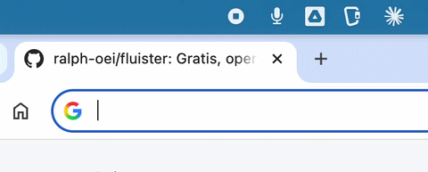

# Fluister

**Gratis, open source, 100% lokaal dicteren op macOS.** ⌥Space ingedrukt houden, praten, klaar. Je stem verlaat je Mac niet.

[](https://github.com/ralph-oei/fluister/actions/workflows/ci.yml)
[](https://github.com/ralph-oei/fluister/actions/workflows/codeql.yml)
[](LICENSE)



Houd de sneltoets ingedrukt, spreek een zin, laat los. Binnen een seconde staat de
tekst waar je cursor stond, in welke app dan ook. Chatvenster, mail, Obsidian, een
zoekbalk. Geen cloud, geen abonnement, geen account.

## Waarom

Dicteren is fijn. Maar de meeste dicteer-apps sturen je stem naar een server van
iemand anders, vragen een abonnement, of allebei. Fluister niet. Alles gebeurt op
je eigen Mac, op de Neural Engine, via [WhisperKit](https://github.com/argmaxinc/WhisperKit).

- **Gratis en open source.** MIT. Lees de code, bouw 'm zelf, pas 'm aan.
- **100% lokaal.** Je audio en tekst blijven op je apparaat.
- **Geen abonnement, geen account, geen telemetrie.**

## Installeren

1. Download de laatste `Fluister.dmg` bij [Releases](https://github.com/ralph-oei/fluister/releases/latest).
2. Open de DMG, sleep Fluister naar Applications.
3. Start Fluister. De app leidt je bij de eerste start door 2 toestemmingen.
4. Houd **⌥Space** ingedrukt, praat, en laat los.

Vereist macOS 14 of nieuwer op Apple Silicon. Bij de eerste start downloadt de app
eenmalig het spraakmodel (zie [100% lokaal, op 1 ding na](#100-lokaal-op-1-ding-na)).

> De eerste release-DMG volgt binnenkort. Tot die tijd bouw je 'm [zelf](#zelf-bouwen).

## Waarom deze permissies?

Fluister vraagt om 2 dingen. Allebei nodig, geen van beide eng:

- **Microfoon** — om je stem lokaal te transcriberen. Er gaat niks naar de cloud.
- **Toegankelijkheid** — om de tekst op je cursor te plakken. Fluister leest je
  toetsaanslagen **niet**. Het gebruikt deze permissie alleen om te plakken, niet
  om te lezen.

De app is bewust niet gesandboxt, want system-wide tekst invoegen kan niet vanuit
de macOS-sandbox. Daarom komt Fluister ook niet uit de App Store, maar als een door
Apple genotariseerde download. Meer hierover in [`SECURITY.md`](SECURITY.md).

## 100% lokaal, op 1 ding na

Eerlijk is eerlijk: Fluister maakt precies 1 soort netwerkverbinding. Bij de eerste
start downloadt WhisperKit het spraakmodel (`small`) en cachet dat lokaal. Daarna
werkt de app volledig offline.

Je stem, je opnames en je getranscribeerde tekst gaan **nooit** het netwerk op. Er is
geen server, geen logging, geen fallback naar de cloud. Wil je het controleren? De code
is open, en `SECURITY.md` legt elk oppervlak uit.

## Zelf bouwen

```bash
git clone https://github.com/ralph-oei/fluister.git
cd fluister
brew install xcodegen
xcodegen generate
open Fluister.xcodeproj   # Cmd R
```

Volledige Xcode vereist (voor WhisperKit/CoreML). Zie [`CONTRIBUTING.md`](CONTRIBUTING.md)
voor meer.

## FAQ

**Is dit een keylogger?**
Nee. De Toegankelijkheid-permissie wordt alleen gebruikt om tekst te *plakken* op je
cursor, niet om je invoer te lezen of te registreren. De code is open, check 'm zelf.

**Waar gaat mijn audio heen?**
Nergens. De transcriptie gebeurt op je eigen Mac. Er is geen server en geen upload.

**Werkt het offline?**
Ja, na de eenmalige modeldownload bij de eerste start. Daarna heb je geen internet nodig.

**Welke talen?**
Nederlands en Engels, instelbaar in de instellingen.

**Waarom maar 1 model?**
`small` is snel op de Neural Engine, licht genoeg voor een 8GB-Mac, en goed genoeg
voor dagelijks Nederlands. Eén model, geen keuzestress.

**Windows? iOS?**
Nee. Fluister is macOS-only (Apple Silicon).

**Kan het ook filler eruit halen en netjes opmaken, zoals de dure tools?**
Dat is een aparte laag die er misschien later bij komt. De kern hier is: praten, tekst
op je cursor, lokaal.

## Gemaakt door

Fluister is gebouwd door [ralphoei.ai](https://ralphoei.ai) — ai die voor je werkt.

## Licentie

[MIT](LICENSE). Doe ermee wat je wilt.
